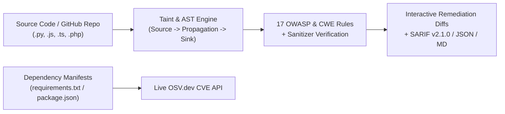

# 🛡️ VulnGuard SAST v2.0 — AST & Taint-Aware Static Code Security & CVE Analyzer


-10b981?style=for-the-badge)

-22c55e?style=for-the-badge)

🌐 **Live Production Demo (Vercel):** [**https://vulnguard-sast.vercel.app**](https://vulnguard-sast.vercel.app)  
📦 **GitHub Pages Mirror:** [**https://prattaydev.github.io/vulnguard-sast/**](https://prattaydev.github.io/vulnguard-sast/)

**VulnGuard SAST v2.0** is a defensive **Static Application Security Testing (SAST)**, **Multi-Line Taint Analysis**, and **Software Composition Analysis (SCA)** platform built for secure code review, DevSecOps pipelines, and cybersecurity engineering.

---

## ✨ Key Capabilities (v2.0)

1. **Multi-Line Source-to-Sink Taint Analysis & Python AST Engine (`js/engine.js`, `cli/vulnguard.py`)**
   - Tracks untrusted user input **Sources** (`request.args`, `req.query`, `$_GET`, `sys.argv`), **Propagations** across variable assignments, and dangerous **Sinks** (`cursor.execute`, `os.system`, `subprocess`, `eval`, `send_file`, `include`).
   - Recognizes **Sanitizers** (`secure_filename`, `escapeshellarg`, `htmlspecialchars`, `DOMPurify.sanitize`, `int()`) to eliminate false positives on hardened code.
   - Displays visual **Source $\rightarrow$ Propagation $\rightarrow$ Sink Data-Flow Taint Traces** directly on finding cards.
2. **Live Public GitHub Repository Multi-File Scanner**
   - Paste any public GitHub repository (`owner/repo` or URL) in the web dashboard to fetch its file tree via the GitHub API and audit its Python, Node.js, and PHP files in one click.
3. **OASIS SARIF v2.1.0, JSON, & Markdown Audit Exports**
   - Export findings in **OASIS SARIF v2.1.0** format (`--sarif` in CLI or `⬇ SARIF` in the Web UI) for direct integration with **GitHub Code Scanning**.
4. **Live Dependency & CVE Scanner (`OSV.dev` API)**
   - Parses `requirements.txt` (PyPI) and `package.json` (npm) manifests and queries the live [OSV.dev](https://osv.dev) database for known CVEs and GHSA advisories.
5. **Automated Unit Test Suite (`tests/test_engine.mjs`, `tests/test_scanner.py`)**
   - Verifies multi-line taint detection, zero false positives on hardened reference code, and SARIF v2.1.0 schema compliance.

---

## 🏗️ Architecture Workflow



---

## 🔍 Vulnerability Detection Matrix

| Rule / Engine ID | Category | CWE | OWASP Top 10 (2021) | Severity | Detection Method |
| :--- | :--- | :--- | :--- | :--- | :--- |
| `VG-TAINT-SQLI` / `VG-AST-SQLI` | **SQL Injection (SQLi)** | CWE-89 | A03:2021 - Injection | `CRITICAL` (9.8) | AST + Multi-Line Taint + Regex |
| `VG-TAINT-RCE` / `VG-AST-RCE` | **Remote Code Execution (RCE)** | CWE-78 / CWE-94 / CWE-502 | A03:2021 / A08:2021 | `CRITICAL` (9.8) | AST + Multi-Line Taint + Regex |
| `VG-TAINT-LFI` / `VG-LFI-001..004` | **Local File Inclusion (LFI) / Path Traversal** | CWE-22 / CWE-98 | A01:2021 / A03:2021 | `CRITICAL` / `HIGH` | Multi-Line Taint + Regex |
| `VG-XSS-001..003` | **Cross-Site Scripting (XSS & SSTI)** | CWE-79 | A03:2021 - Injection | `HIGH` (7.5–8.1) | Contextual Pattern Analysis |
| `VG-SEC-001..003` / `VG-AST-SEC` | **Hardcoded Secrets & Weak Crypto** | CWE-798 / CWE-327 / CWE-295 | A02:2021 / A07:2021 | `HIGH` / `MEDIUM` | AST Constant Assignment + Regex |

---

## 🚀 Quick Start & CLI Usage

### 1. Run the Automated Unit Tests
```bash
# Node.js Test Runner (SAST + Taint + SARIF tests)
npm test

# Python unittest Runner (AST CLI + SARIF tests)
python -m unittest discover -s tests
```

### 2. Command-Line Scanner (`cli/vulnguard.py`)
```bash
# Standard human-readable security audit
python cli/vulnguard.py path/to/code

# Export OASIS SARIF v2.1.0 for GitHub Code Scanning
python cli/vulnguard.py path/to/code --sarif > results.sarif

# Export structured JSON for CI/CD gating
python cli/vulnguard.py path/to/code --json
```

---

## 📂 Project Structure

```text
vulnguard-sast/
├── index.html               # Interactive SAST, GitHub Repo Scanner & CVE Dashboard
├── css/
│   └── styles.css           # Dark-mode styling & synchronized code gutter
├── js/
│   ├── engine.js            # Source-to-Sink Taint Analyzer, GitHub Repo Scanner, SARIF builder
│   ├── rules.js             # 17 CWE/OWASP signatures & secure code remediations
│   ├── samples.js           # Vulnerable & hardened code samples (Python, Node.js, PHP)
│   ├── app.js               # UI controller, taint flow visualizer, report exporters
│   └── bundle.js            # Browser runtime bundle
├── cli/
│   └── vulnguard.py         # Python AST + Taint CLI scanner with --sarif & --json support
├── tests/
│   ├── test_engine.mjs      # Node.js automated test suite
│   └── test_scanner.py      # Python AST automated unit tests
├── vercel.json              # Vercel deployment & HTTP security headers configuration
└── package.json             # Project configuration & test scripts
```
