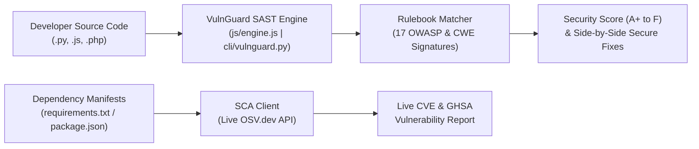

# 🛡️ VulnGuard SAST — Static Code Security & Dependency CVE Analyzer


-10b981?style=for-the-badge)


🌐 **Live Production Demo (Vercel):** [**https://vulnguard-sast.vercel.app**](https://vulnguard-sast.vercel.app)  
📦 **GitHub Pages Mirror:** [**https://prattaydev.github.io/vulnguard-sast/**](https://prattaydev.github.io/vulnguard-sast/)

**VulnGuard SAST** is a defensive **Static Application Security Testing (SAST)** and **Software Composition Analysis (SCA)** platform built for secure code review, DevSecOps pipelines, and cybersecurity education.

It inspects source code across **Python**, **JavaScript / Node.js**, and **PHP** to identify high-risk vulnerability patterns—including **SQL Injection (SQLi)**, **Remote Code Execution (RCE)**, **Local File Inclusion (LFI) / Path Traversal**, **Cross-Site Scripting (XSS)**, and **Hardcoded Secrets / Weak Cryptography**—and provides side-by-side **Secure Code Remediations** mapped to **MITRE CWE** and **OWASP Top 10 (2021)**.

---

## ✨ Key Features

1. **Multi-Language SAST Engine (`Python`, `Node.js/JS`, `PHP`)**
   - Detects 17+ high-confidence insecure coding patterns with automatic language detection.
   - Highlights vulnerable line numbers in an interactive editor and provides **side-by-side vulnerable vs. remediated code diffs**.
   - Calculates a **Security Posture Score (0–100)** and **Letter Grade (`A+` to `F`)**.
2. **Live Dependency & CVE Scanner (`OSV.dev` Integration)**
   - Parses `requirements.txt` (PyPI) and `package.json` (npm) manifests and queries the live [OSV.dev](https://osv.dev) database for known CVEs and GHSA security advisories.
3. **Exportable Audit Reports**
   - Export findings to structured **JSON** or **Markdown (`.md`)** security audit reports.
4. **Zero-Dependency Python CLI (`cli/vulnguard.py`)**
   - Run automated static security scans locally or in GitHub Actions CI/CD pipelines.

---

## 🏗️ Architecture Workflow



---

## 🔍 Vulnerability Detection Matrix

| Rule ID | Category | CWE | OWASP Top 10 (2021) | Severity | Target Languages |
| :--- | :--- | :--- | :--- | :--- | :--- |
| `VG-SQLI-001..004` | **SQL Injection (SQLi)** | CWE-89 | A03:2021 - Injection | `CRITICAL` (9.8) | Python, JS, PHP |
| `VG-RCE-001..006` | **Remote Code Execution (RCE)** | CWE-78 / CWE-94 / CWE-502 | A03:2021 / A08:2021 | `CRITICAL` (9.8) | Python, JS, PHP |
| `VG-LFI-001..004` | **Local File Inclusion (LFI) / Path Traversal** | CWE-22 / CWE-98 | A01:2021 / A03:2021 | `CRITICAL` / `HIGH` | Python, JS, PHP |
| `VG-XSS-001..003` | **Cross-Site Scripting (XSS & SSTI)** | CWE-79 | A03:2021 - Injection | `HIGH` (7.5–8.1) | Python, JS, PHP |
| `VG-SEC-001..003` | **Hardcoded Secrets & Weak Crypto** | CWE-798 / CWE-327 / CWE-295 | A02:2021 / A07:2021 | `HIGH` / `MEDIUM` | Python, JS, PHP |

---

## 🚀 Quick Start

### 1. Web Dashboard (Local or Vercel)
Because the web dashboard uses native ES Modules, you can serve the root directory with any static server or deploy directly to **Vercel**:

```bash
# Using Python built-in HTTP server
python -m http.server 8080

# Or using Node.js serve
npx serve .
```
Then open `http://localhost:8080` in your browser.

### 2. Command-Line Scanner (CLI)
Scan any file or directory from your terminal using the standalone Python CLI:

```bash
# Human-readable terminal report
python cli/vulnguard.py path/to/project

# JSON output for CI/CD pipelines
python cli/vulnguard.py path/to/project --json
```

---

## 📂 Project Structure

```text
vulnguard-sast/
├── index.html          # Main interactive SAST & CVE Scanner web dashboard
├── css/
│   └── styles.css      # Custom dark-mode styling & editor layout
├── js/
│   ├── app.js          # UI controller, editor gutter sync, report exporter
│   ├── engine.js       # Core SAST pattern engine & OSV.dev API client
│   ├── rules.js        # 17 CWE/OWASP detection signatures & secure code fixes
│   └── samples.js      # Built-in vulnerable & hardened samples (Python, Node.js, PHP)
├── cli/
│   └── vulnguard.py    # Zero-dependency Python CLI scanner for CI/CD
├── vercel.json         # Vercel deployment & security headers configuration
└── package.json        # Project metadata
```

---

## ⚖️ Ethical & Defensive Use Notice

VulnGuard SAST is a **defensive static analysis and dependency auditing tool** designed exclusively for secure code review, vulnerability remediation, and cybersecurity education. It does not generate or transmit offensive payloads.
